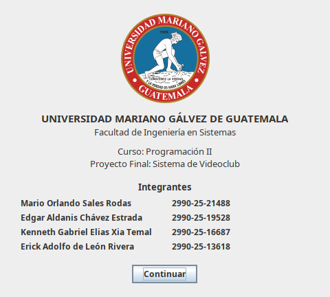
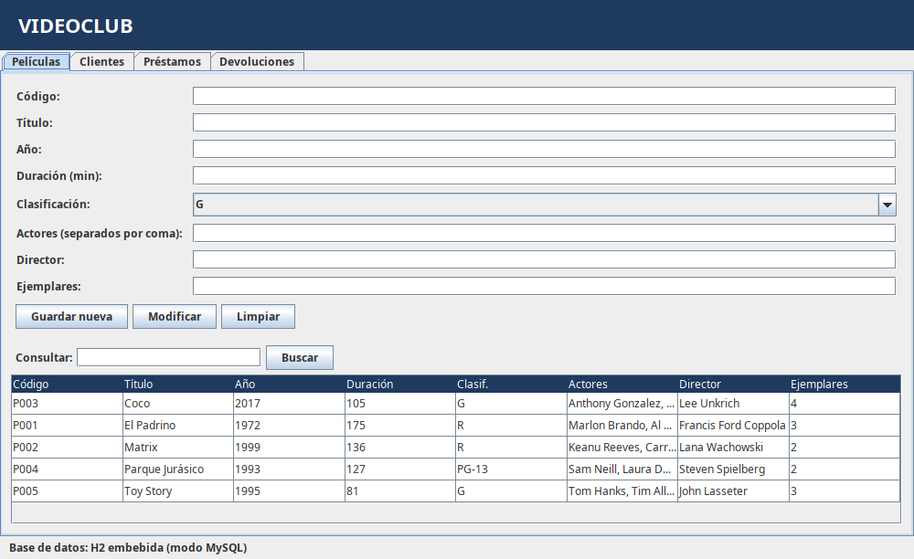
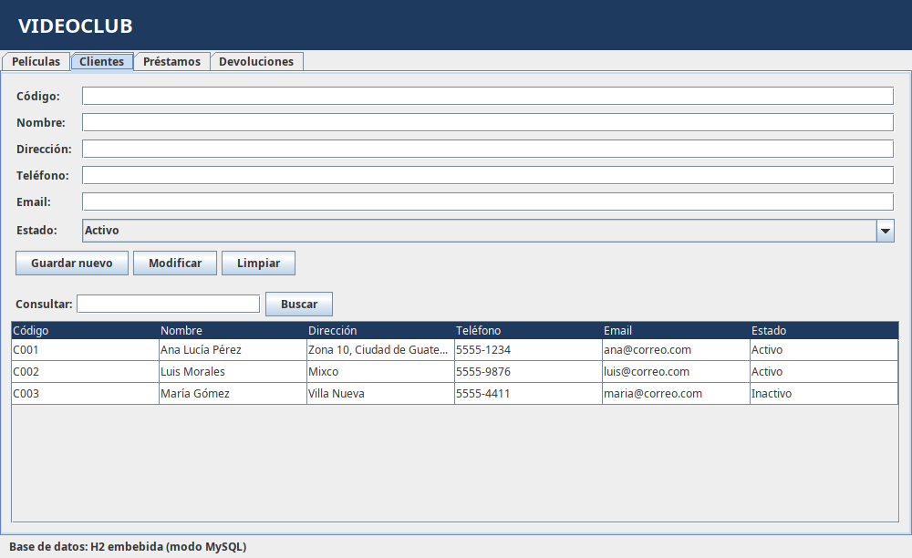
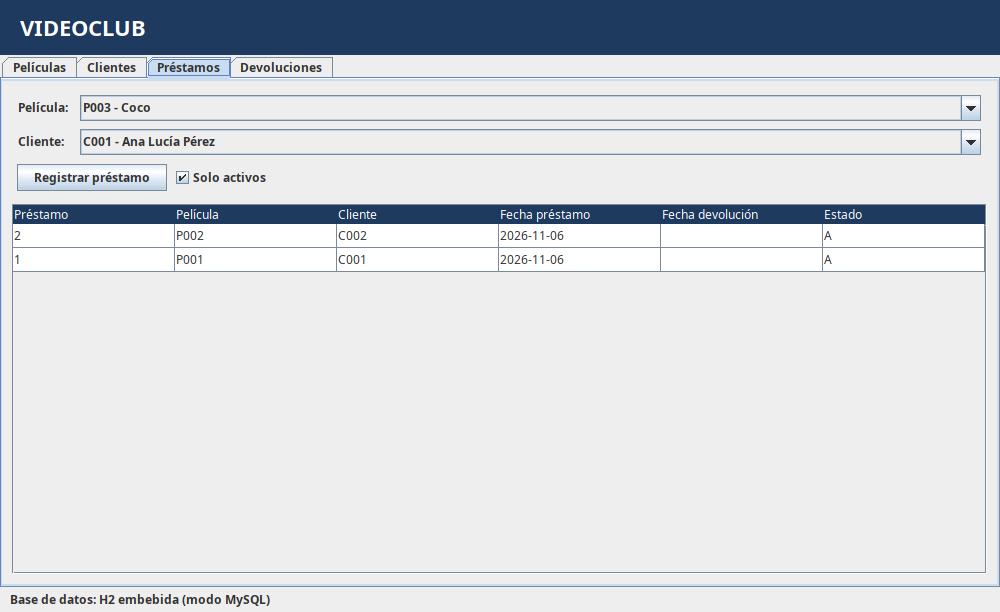
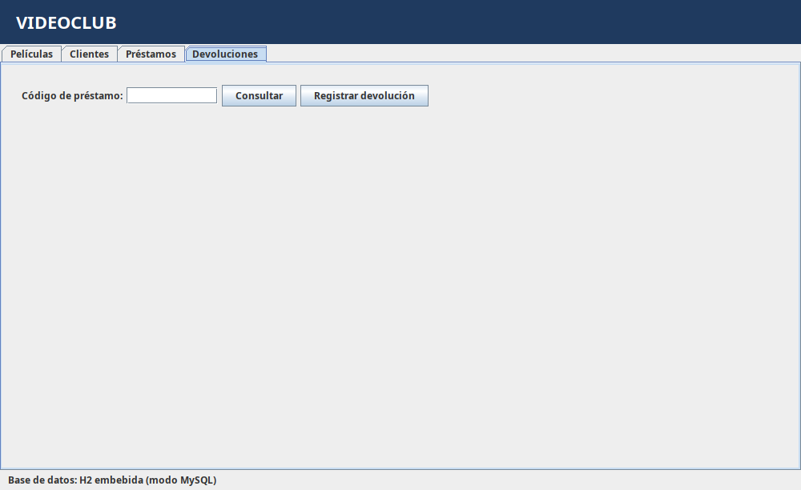
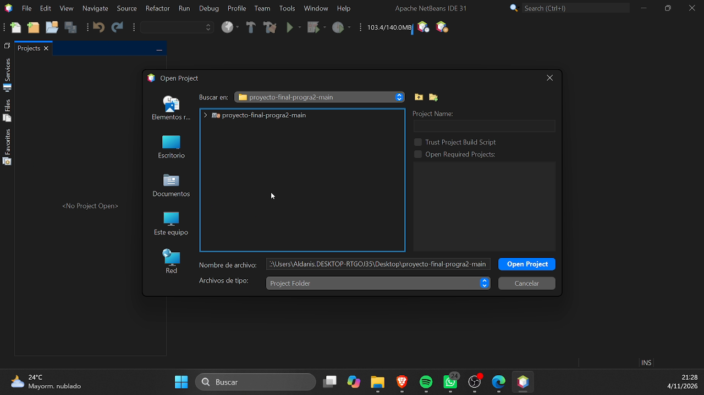
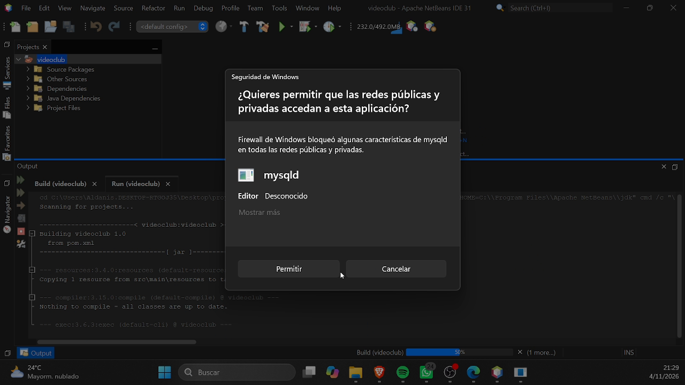

# Videoclub – Proyecto Final Programación II

Sistema de escritorio en **Java + Swing** para controlar una colección de películas, los clientes y los préstamos.
La base de datos viene incluida: no hace falta instalar MySQL ni configurar nada para probarlo.

| | |
|---|---|
| **Universidad** | Universidad Mariano Gálvez de Guatemala |
| **Facultad** | Ingeniería en Sistemas |
| **Curso** | Programación II |

| Integrante | Carné |
|---|---|
| Mario Orlando Sales Rodas | 2990-25-21488 |
| Edgar Aldanis Chávez Estrada | 2990-25-19528 |
| Kenneth Gabriel Elias Xia Temal | 2990-25-16687 |
| Erick Adolfo de León Rivera | 2990-25-13618 |

## Capturas

Carátula, que se muestra modal al iniciar la aplicación:



| Películas | Clientes |
|---|---|
|  |  |

| Préstamos | Devoluciones |
|---|---|
|  |  |

## Requisitos

- **Java JDK 17 o superior.** Para comprobarlo, abre una terminal (o CMD / PowerShell) y escribe:
  ```
  java -version
  ```
  Si no aparece o la versión es menor que 17, descárgalo de [adoptium.net](https://adoptium.net) (Temurin).
- **Apache NetBeans** (cualquier versión reciente). Incluye Maven, así que no hay que instalarlo aparte.
- **Internet** solo la primera vez, para que NetBeans descargue las librerías del proyecto.

## Cómo ejecutar (con NetBeans)

1. **Extrae** el proyecto en una carpeta. Se recomienda una ruta sin tildes ni espacios, por ejemplo `C:\Proyectos\videoclub`.
2. Abre **Apache NetBeans** y ve a **File → Open Project**.
3. Selecciona la carpeta **`videoclub`** (la que contiene el archivo `pom.xml`) y pulsa **Open Project**.

   

4. Espera a que NetBeans termine de compilar y descargar las librerías (se ve en la parte inferior, en *Output*).
5. Haz clic derecho sobre el proyecto y elige **Run**, o usa el botón verde **Run Project** de la barra superior.
6. Si NetBeans pregunta la clase principal (*Select Main Class*), elige **`videoclub.Main`** y pulsa **Select Main Class**. Solo se pide una vez por sesión.
7. Aparece la **carátula**. Pulsa **Continuar** para entrar al sistema.

> **Aviso de Firewall de Windows:** al ejecutar puede aparecer un aviso de *Seguridad de Windows* sobre `mysqld`. Puedes elegir **Cancelar**: el sistema funciona con la base de datos H2 que viene incluida.



### Ejecutar desde la terminal (opcional)

Con JDK 17+ y Maven instalados:

```
mvn package
java -jar target/app.jar
```

Hay que ejecutarlo desde la carpeta del proyecto, porque ahí se crea la carpeta `data/`.

## Uso del sistema

El sistema tiene cuatro pestañas:

- **Películas:** registrar, modificar y consultar películas (código, título, año, duración, clasificación, actores, director y ejemplares).
- **Clientes:** registrar, modificar y consultar clientes, con estado *Activo* o *Inactivo*.
- **Préstamos:** registrar un préstamo de una película a un cliente activo. Si no quedan ejemplares disponibles, el sistema lo avisa.
- **Devoluciones:** consultar un préstamo por su código y registrar su devolución.

En la barra inferior de la ventana aparece el motor de base de datos que está en uso.
Los datos se guardan en la carpeta `data/` dentro del proyecto, así que se conservan entre ejecuciones.

## Base de datos

Por defecto el sistema usa **H2 en modo MySQL**, una base embebida que no requiere instalación.

Para usar un servidor **MySQL** propio, edita `config.properties`:

```properties
modo=mysql
mysql.url=jdbc:mysql://localhost:3306/videoclub?createDatabaseIfNotExist=true
mysql.usuario=root
mysql.clave=TU_CLAVE
```

- `modo=auto` (valor por defecto): usa MySQL si `mysql.url` está escrito; si no conecta, usa la base embebida.
- `modo=mysql`: exige MySQL; si no conecta, muestra el error.
- `modo=embebida`: usa siempre la base embebida.

Las tablas se crean solas al iniciar, a partir de `src/main/resources/schema.sql`.

## Problemas comunes

| Problema | Solución |
|---|---|
| NetBeans dice que falta Java o pide una plataforma | *Tools → Java Platforms*: agrega un JDK 17 o superior y vuelve a abrir el proyecto. |
| No se descargan las librerías | Verifica la conexión a internet y haz clic derecho en el proyecto → **Clean and Build**. |
| Error al iniciar la base de datos | Mueve la carpeta del proyecto a una ruta sin tildes ni espacios y vuelve a ejecutar. |
| Los datos desaparecen entre ejecuciones | Ejecuta desde la carpeta del proyecto: los datos se guardan en `data/`. |

## Estructura del proyecto

```
videoclub/
├── pom.xml                    Configuración Maven (NetBeans la lee directamente)
├── config.properties          Configuración de la base de datos
└── src/main/
    ├── java/videoclub/
    │   ├── Main.java          Punto de entrada
    │   ├── db/                Conexión y excepciones
    │   ├── model/             Películas, clientes, préstamos y estados
    │   ├── dao/               Acceso a datos y reglas de negocio
    │   └── ui/                Ventanas y pestañas (Swing)
    └── resources/             Esquema SQL y logo
```
